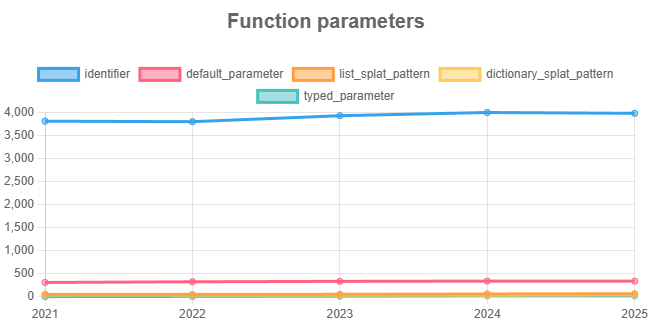

# Explorando evolução de código

Neste exercício, iremos explorar a evolução de código em sistemas reais.

Iremos utilizar a ferramenta [GitEvo](https://github.com/andrehora/gitevo).
Essa ferramenta analisa a evolução de código em repositórios Git nas linguagens Python, JavaScript, TypeScript e Java, e gera relatórios `HTML` como [este](https://andrehora.github.io/gitevo-examples/python/pandas.html).

Mais exemplos de relatórios podem ser podem ser encontrados em https://github.com/andrehora/gitevo-examples.

# Passo 1: Selecionar repositório a ser analisado

Selecione um repositório relevante na linguagem de sua preferência (Python, JavaScript, TypeScript ou Java).
Você pode encontrar projetos interessantes nos links abaixo:

- Python: https://github.com/topics/python?l=python
- JavaScript: https://github.com/topics/javascript?l=javascript
- TypeScript: https://github.com/topics/typescript?l=typescript
- Java: https://github.com/topics/java?l=java

# Passo 2: Instalar e rodar a ferramenta GitEvo

> [!NOTE]
> Antes de instalar a ferramenta, é recomendado criar e ativar um [ambiente virtual Python](https://packaging.python.org/en/latest/guides/installing-using-pip-and-virtual-environments/#create-and-use-virtual-environments).

Instale a ferramenta [GitEvo](https://github.com/andrehora/gitevo) com o comando:

```
$ pip install gitevo
```

Execute a ferramenta no repositório selecionado utilizando o comando abaixo (ajuste conforme a linguagem do repositório).
Substitua `<git_url>` pela URL do repositório que será analisado:

```shell
# Python
$ gitevo -r python <git_url>

# JavaScript
$ gitevo -r javascript <git_url>

# TypeScript
$ gitevo -r typescript <git_url>

# Java
$ gitevo -r java <git_url>
```

Por exemplo, para analisar o projeto Flask escrito em Python:

```
$ gitevo -r python https://github.com/pallets/flask
```

> [!NOTE]
> Essa etapa pode demorar alguns minutos pois o projeto será clonado e analisado localmente.

# Passo 3: Explorar o relatório de evolução de código

Após executar a ferramenta [GitEvo](https://github.com/andrehora/gitevo), é gerado um relatório `HTML` contendo diversos gráficos sobre a evolução do código.

Abra o relatório `HTML` e observe com atenção os gráficos.

# Passo 4: Explicar um gráfico de evolução de código

Selecione um dos gráficos de evolução e explique-o com suas palavras.
Por exemplo, você pode:

- Detalhar a evolução ao longo do tempo
- Detalhar se as curvas estão de acordo com boas práticas
- Explicar grandes alterações nas curvas
- Explorar a documentação do repositório em busca de explicações para grandes alterações
- etc.

Seja criativo!

# Instruções para o exercício

1. Crie um `fork` deste repositório (mais informações sobre forks [aqui](https://docs.github.com/pt/pull-requests/collaborating-with-pull-requests/working-with-forks/fork-a-repo)).
2. Adicione o relatório `HTML` no seu fork.
3. No Moodle, submeta apenas a URL do seu `fork`.

Responda às questões abaixo diretamente neste arquivo `README.md` do seu fork:

1. Repositório selecionado: https://github.com/pygame/pygame
2. Gráfico selecionado: Function parameters de 2021 a 2025

   

   Relatório completo: [report_pygame.html](report_pygame.html)
3. Explicação:  Quanto mais parâmetros uma função tem, mais difícil ela fica de chamar, entender e testar, então olhei o gráfico para ver se o pygame estava complicando as funções com o tempo.
A linha azul, que conta os parâmetros comuns, que quase não mudou 3.809 em 2021, 3.798 em 2022, 3.928 em 2023, 3.998 em 2024 e 3.980 em 2025. As funções também cresceram pouco, de 3.178 para 3.365. Fazendo a divisão, dá mais ou menos 1,2 parâmetro por função em todos os anos. Os parâmetros com valor padrão foram de 307 para 335, e os parâmetros que aceitam uma quantidade qualquer de valores de 49 para 63, enquanto os que aceitam uma quantidade qualquer de valores com nome ficaram parados entre 32 e 38.
Como a média é baixa e não subiu, acho que o pygame segue a boa prática de manter funções com poucos parâmetros, e usa pouco esses parâmetros que aceitam uma quantidade qualquer de valores perto do total de funções. O limite do gráfico é que ele só mostra o total, então não dá para saber se existem funções específicas com muitos parâmetros.
Não tem nenhum salto grande no gráfico, mas o que me chamou atenção foi a queda de 2021 para 2022 (3.809 para 3.798), que acompanha a queda no número de arquivos Python, de 209 para 198, então deve ser por arquivos removidos. Também a linha de parâmetros com tipo anotado, que sai de 0 em 2021, vai para 4, 9 e 16 e fica em 16 em 2025, sendo a única que cresce de forma clara, mas continua muito pequena perto de quase 4 mil parâmetros.
Fui olhar o repositório para entender isso, o pygame guarda os tipos em arquivos separados (.pyi), na pasta [buildconfig/stubs](https://github.com/pygame/pygame/tree/main/buildconfig/stubs), e tem PRs sobre isso, como o [#2050](https://github.com/pygame/pygame/pull/2050) (atualização dos stubs, 2020) e o [#2537](https://github.com/pygame/pygame/pull/2537). Isso explica por que quase não há anotações dentro dos arquivos .py, não achei nenhum commit que explique por que algumas anotações começaram a aparecer em 2022.

